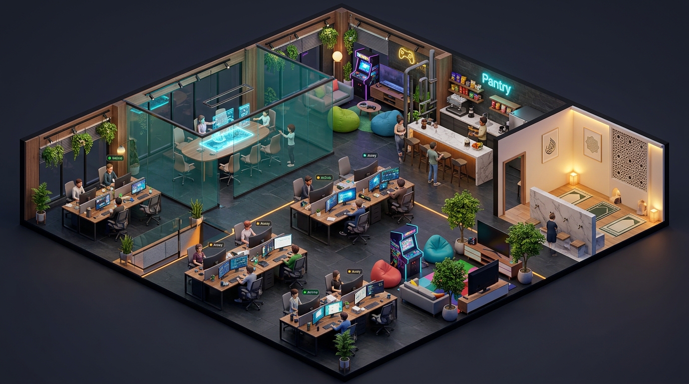

# 🌙 Kantor AI — 3D AI Office

**Lu tidur, AI lembur.** A self-hosted personal AI office: division teams of agents
(OpenCode runtime) work the night shift on your machine, ask only for decisions,
and you wake up to a dashboard, a 3D office, and a single morning digest.

Inspired by [lembur.id](https://lembur.id). Built with Next.js + TypeScript +
React Three Fiber. Single user, own hardware, no cloud lock-in.



## What it does

- **Night shift orchestration** — per-division wake times (22:00–06:00 WIB),
  `after` dependencies, skip-if-idle, one retry, sequential to bound cost
- **Decision queue, not actions** — agents propose via `decisions.json`; money,
  outbound sends, deletes, and customer PII execute only through the
  code-locked `tools-gateway.ts` after you tap Setuju
- **Deterministic tools** — totals, ROAS, P&L, validators are computed by
  scripts, never estimated by the model
- **3D office** — pods per team, walking robot avatars with real gait cycles,
  ambient life (bots wander to lounge/pantry/musholla on their own),
  meeting room with live ops board, day/night lighting, camera presets
- **Owner chat** — talk to any division (`ngobrol`), broadcast to all,
  assign tasks in plain words, summon bots across rooms by chatting
- **Builder** — the office grows itself: interview → new division scaffolded

## Quickstart

```bash
npm install
cp .env.example .env   # set KANTOR_MODEL to a working provider/model id
npm run dev            # http://localhost:3000/kantor
```

Fire a shift manually:

```bash
node scripts/wake.mjs <member-id>   # e.g. node scripts/wake.mjs gilang
node scripts/wake.mjs --force       # orchestrated pass (respects night window otherwise)
```

Overnight automation (macOS):

```bash
cp cron/id.kantor.tick.plist ~/Library/LaunchAgents/
launchctl load ~/Library/LaunchAgents/id.kantor.tick.plist
```

Morning digest via Telegram: create a bot with `@BotFather`, then
`launchctl setenv TELEGRAM_BOT_TOKEN x` + `TELEGRAM_CHAT_ID y`,
test with `node scripts/digest.mjs`, and load `cron/id.kantor.digest.plist`.

## Layout

```
agents/<division>/[members/<name>/]  SYSTEM.md + opencode.json + workspace/
agents/schedule.json                 wake times, deps, window
app/kantor/                          3D office + command deck (decisions/chat/piutang)
app/api/                             tick, decisions, chat, presence, status
lib/                                 db (node:sqlite), runner, orchestrator, gateway
scripts/                             wake.mjs, digest.mjs, malam-off.sh, pagi-on.sh
```

## Team

15 members across 9 divisions: sales, ads, sosmed (+content/video/design),
quotes, finance, catalog, web (+backend/QA), admin, builder, plus a creative
unit. See [PLAN.md](PLAN.md).

## Notes

- Needs an [OpenCode](https://opencode.ai)-compatible model provider; agent runs
  take 10–20 min each and cost tokens — the scheduler exists to bound this.
- Personal-use project; guardrails are code-enforced but review approvals
  carefully before tapping Setuju on money moves.
